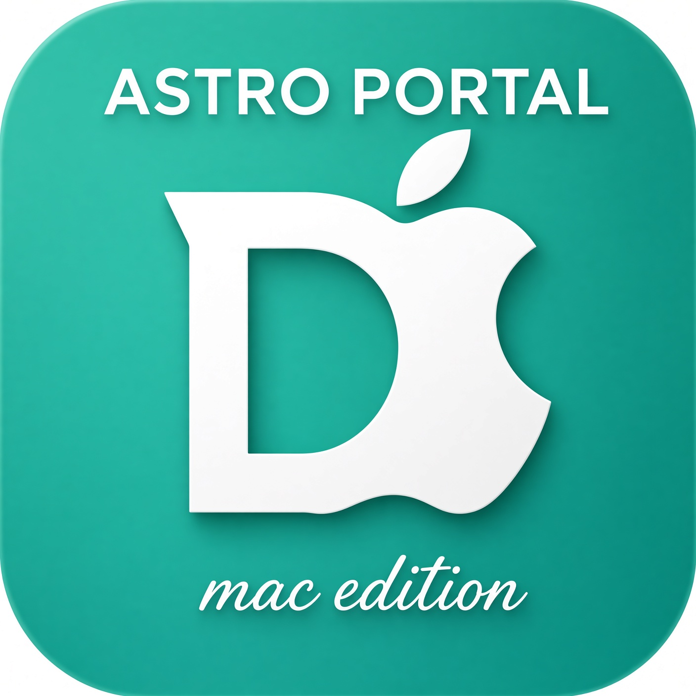

# Astro Portal 1.1 — for macOS

Run the original **DWARFLAB Android app** in a dedicated Android environment on a Mac. Astro Portal provides a graphical launcher, saved observing coordinates, Mac location and clock forwarding, fullscreen display, and a vendor-app update button.

**[Download version 1.1](https://github.com/Xee-Astro/astro-portal-mac/releases/tag/v1.1)** · [Installer ZIP](https://github.com/Xee-Astro/astro-portal-mac/releases/download/v1.1/Astro-Portal-1.1-macOS.zip) · [Source ZIP](https://github.com/Xee-Astro/astro-portal-mac/releases/download/v1.1/Astro-Portal-Source-1.1.zip)

## What it does

- Detects Apple silicon or Intel and downloads matching Android/display components.
- Runs the original vendor APK in an isolated Android 11 profile.
- Opens **Astro Portal.app** from your Applications folder or Dock.
- Saves manual latitude, longitude, altitude, location-source selection and fullscreen choice.
- Obtains Mac location with your permission and forwards it to Android's GPS provider.
- Synchronizes Android date, time and timezone with the Mac.
- Opens DWARFLAB in fullscreen or a normal resizable window.
- Updates DWARFLAB from the vendor's download link while retaining Android app data.

## Prerequisites

| Requirement | Details |
| --- | --- |
| Computer | Apple silicon or Intel Mac with hardware virtualization |
| macOS | Launcher targets macOS 12+; downloaded Google emulator may require a newer version |
| Memory | 16 GB recommended for Android emulation; smaller-memory Macs are unverified |
| Storage | 12 GB free for fresh setup; additional room for captured images and growing app data |
| Internet | Required for setup downloads and app updates |
| Permissions | Accept Google SDK licenses yourself; permit macOS Location Services only if using Mac location |

No Xcode, Homebrew or Android Studio installation is needed. This is an online installer; the small ZIP does not contain Android, Java or DWARFLAB binaries.

## Install or upgrade

1. Download and extract **Astro-Portal-1.1-macOS.zip**.
2. For a fresh setup run **Install.command**. For the earlier Astro installation, stop Android, quit its launcher and run **Upgrade-Launcher.command**.
3. Follow the prompts, then open **Astro Portal.app** in your home **Applications** folder.
4. Set an observing location and choose **Open DWARFLAB**.

Keep the extracted files together during installation. Setup creates a locally ad-hoc-signed app; it is not Apple-notarized. See [installation help](INSTALLATION.md) for first-open instructions.

## Validation status

Source/package checks and mocked location/settings tests passed on Windows. **The native Mac interface, emulator provisioning, real location permissions, fullscreen display and physical telescope control have not been verified on a Mac by this project.** Version 1.1 identifies this release; it does not imply hardware certification. See [validation details](VALIDATION.md).

Bluetooth pairing, broadcast discovery and Wi-Fi provisioning may behave differently in an emulator. A working launcher does not establish that telescope capture, movement, guiding or firmware operations work.

## Documentation and source

- [Installation, upgrades and removal](INSTALLATION.md)
- [Location, clock, fullscreen and app updates](USER-GUIDE.md)
- [Architecture and source-file map](ARCHITECTURE.md)
- [Development, checks and packaging](DEVELOPMENT.md)
- [Validation and remaining work](VALIDATION.md)
- [Release notes](RELEASE-NOTES.md) and [changelog](CHANGELOG.md)
- [Third-party notices and official sources](THIRD-PARTY.md)
- [Artwork and project licensing status](RIGHTS.md)
- [Report an issue](https://github.com/Xee-Astro/astro-portal-mac/issues)

Astro Portal is an independent project and is not affiliated with or endorsed by DWARFLAB, Apple, Google, Eclipse Adoptium or Genymobile. DWARFLAB and other product names identify their respective owners' products. Mac and macOS are trademarks of Apple Inc.
